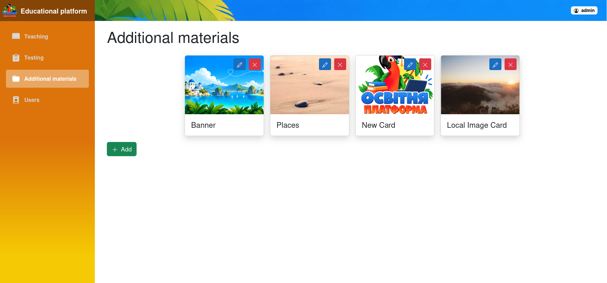
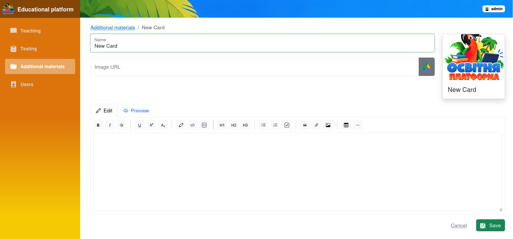

# Additional Materials (Atlas)

The goal here was to make a quick reference dash, so large cards in a grid with pictures are used.
Cards dynamically increase their size to fit the max height of the row in order to not create visual breaks.
Since the display is not a table, but a grid, Edit and Delete buttons had to also move.

# Atlas Form

The editor for each atlas card is a lot like a [Lesson Form](https://github.com/Pandora1337/mt-lms/wiki/2.-Teaching#lesson-form), but with an additional field for image url/path and a preview thumbnail to confirm the chosen image.

The Google Drive button automatically converts shared URL to a thumbnail URL for proper loading.
