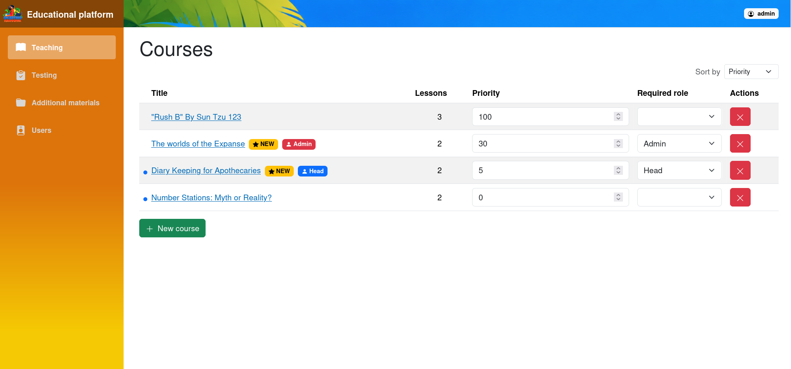
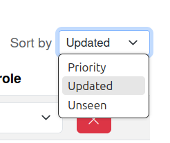
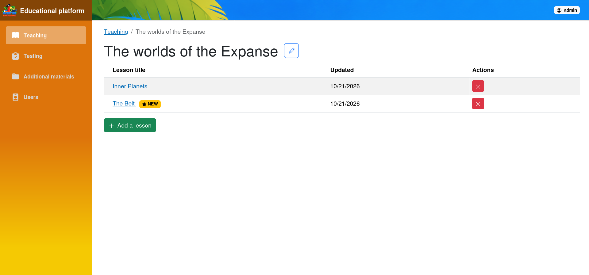
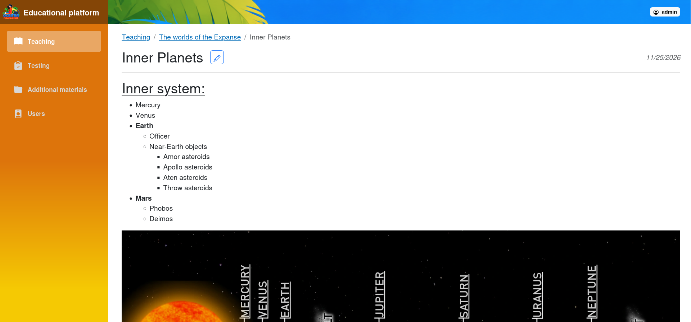
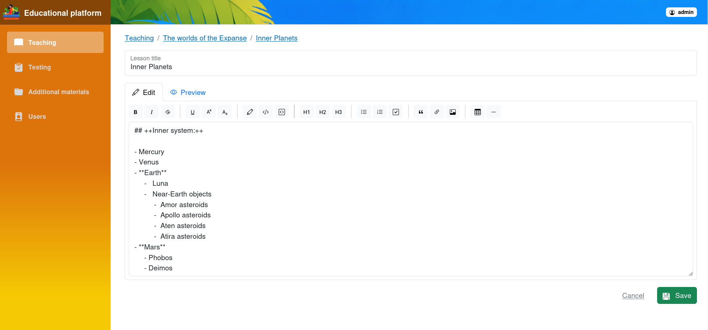
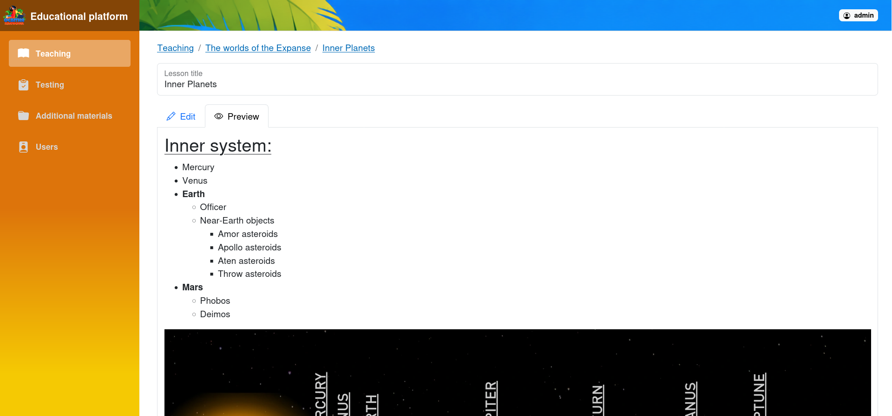

# All Courses


Courses page shows all available courses for the user (Note the `Admin` and `Manager` badges, these courses are only available to those roles)

Each Course Model only contains data for its Id, Title, RequiredRole, and DisplayOrder (+ Navigation property linking to a list of lessons). The data for hints are derived from the lessons in each course JOINED to the course query.

Legend (From left to right):
- The blue dot symbolizes a Seen Course (Course where all lessons have been opened by the user)
- Course name and badges. `NEW` badge signifies a lesson that was updated after the user had opened it (i.e. this course has new information). Other badges show the role required to access them
- Each Course contains a number of Lessons (See below)
- The fields `Order`, `Required Role`, and `Actions` are only available to those that authenticated as Admins



On the top right of the page, the user can sort the Courses:
- `Priority` - Order given to the Course by the Admin
- `Updated` - Sorts by most recently updated lessons
- `Unseen` - Sorts the courses with unseen lessons first

# Course View


Here the user sees all Lessons in a selected Course. Same idea with the blue dot for Seen/Unseen status, and badge for `NEW`.

Authorization is handled by the back-end checking if the parent Course has a matching `RequiredRole`, and if not, redirects to the previous page.

# Lesson View


Each lesson is mostly a Markdown formatted string, rendered to HTML by Markdig NuGet Package on the server. This allows rich text formatting, including embedding images and video links!
This page is Statically Rendered, however the Lesson Form is not.

Same authorization logic applies here as in Course View.

# Lesson Form





This is the first appearance of the custom `MarkdownEditor.razor` component, and also the first Interactively Rendered page. The active connection allows to pass the Markdown text back to server for preview rendering in real-time. Otherwise, the form is fairly standard.

The second such editor is in [Additional Materials Form](https://github.com/Pandora1337/mt-lms/wiki/4.-Additional-Materials#atlas-form).

The routing passes the ID of the Lesson and its parent Course:
```
@page "/training/course/{CourseId:long?}/lesson/{LessonId:long?}/edit"
@page "/training/course/{CourseId:long?}/lesson/new"
```

If the page is `/new/`, then `LessonId == 0`, which then dictates whether to fetch the Lesson from DB or create a new one.

This page is also locked behind `[Authorize(Roles = "Admin")]` attribute, preventing non-admins from editing or creating Lessons.

