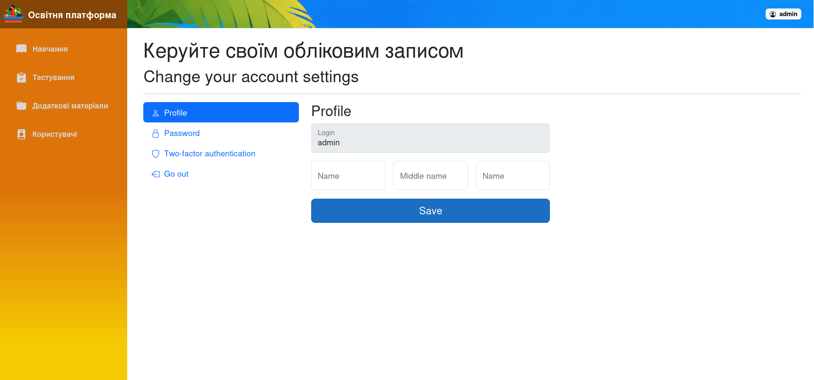
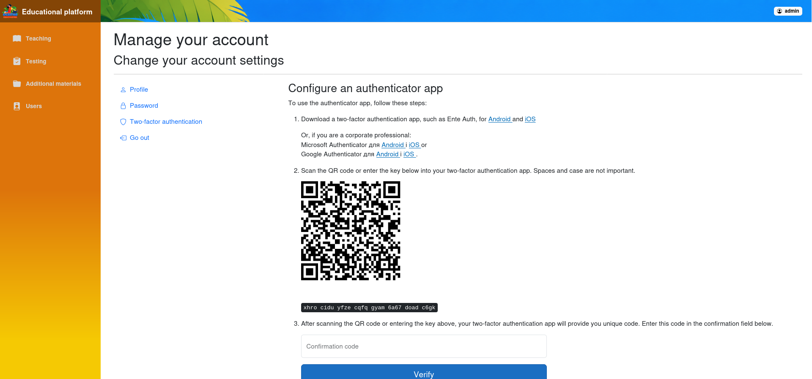

# User Profile

In the user's profile section (accessible from anywhere by clicking on the username on the top right of the header) the user can change their name, change their password, add a 2 factor authenticator, and log out.

# 2FA

Here user can add an authenticator (or download one from relevant app store).

While the core authenticator functionality works without additional packages being needed, you do need a package for generating the QR code. Naturally since its a lot easier to scan the QR code than to enter a long key manually, the NuGet package `Net.Codecrete.QrCodeGenerator` takes care of that. 