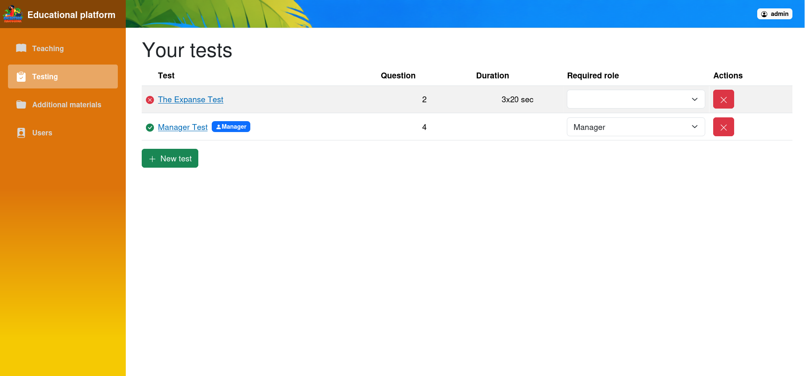
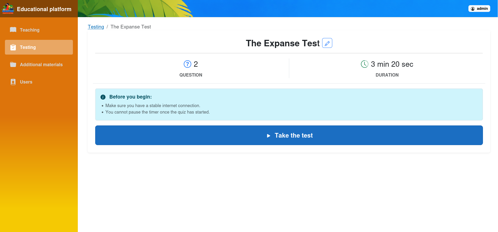
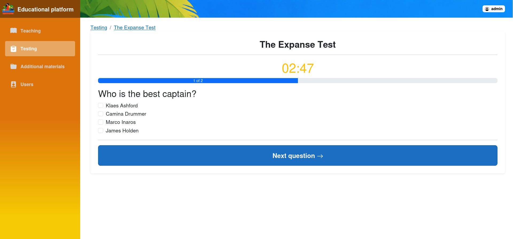
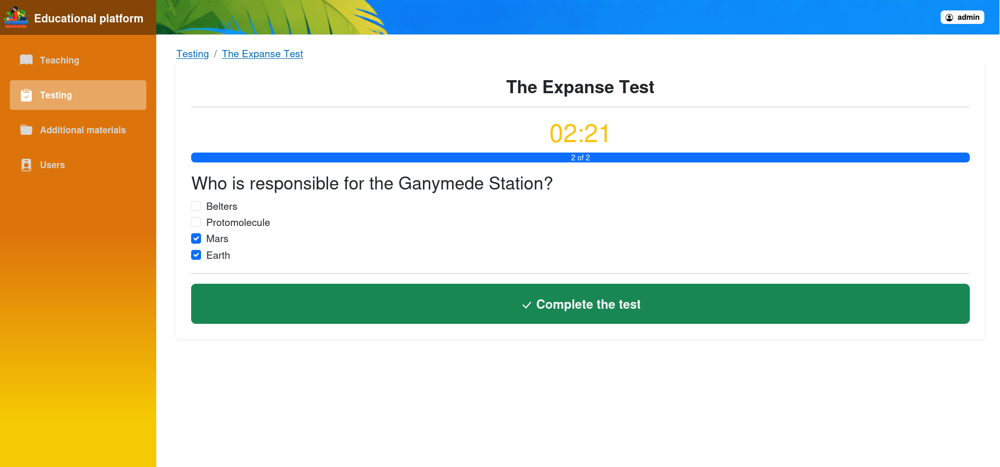
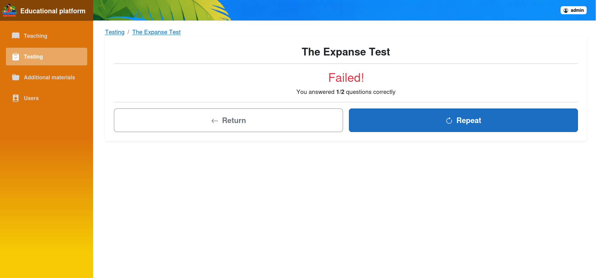
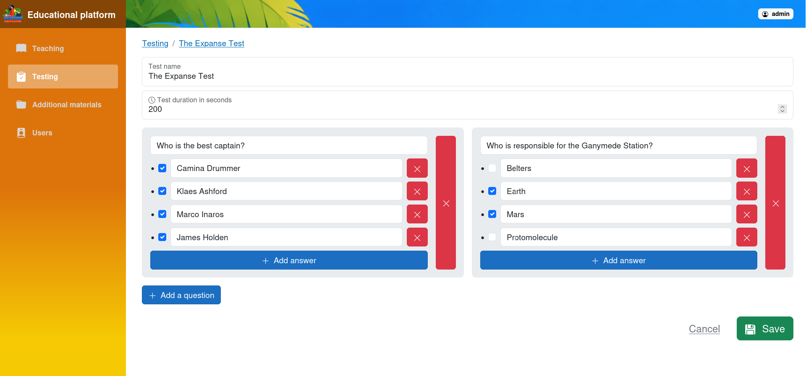
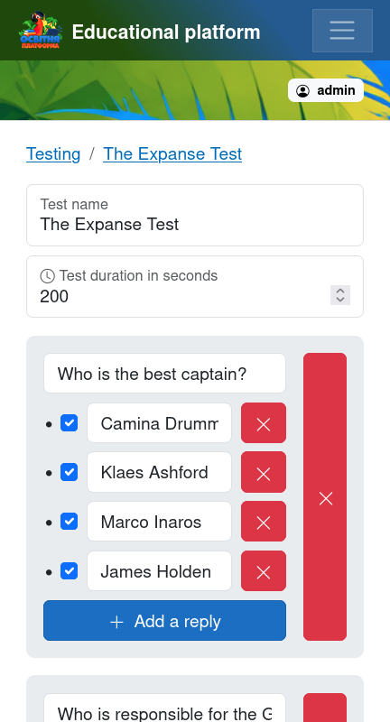
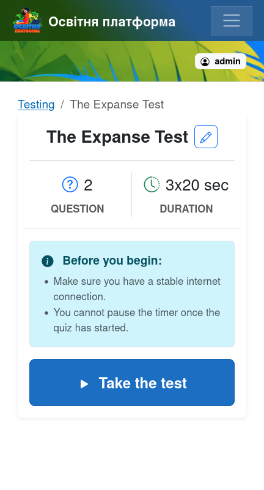
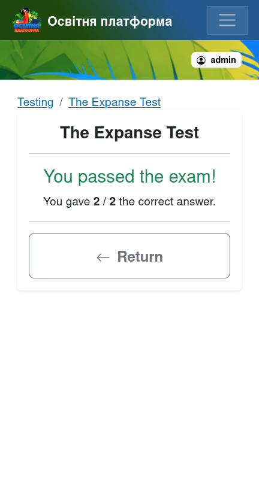

# All Tests

This section is similar to [Teaching](https://github.com/Pandora1337/mt-lms/wiki/2.-Teaching):
- Icons show Failed/Completed/Not Attempted status of the test (Not Attempted will have a blank icon)
- Badges show the role requirement (Entry is hidden if user doesn't have the role)

This is the same list that `Manager`s and `Admin`s see when they click a username on the [Users](https://github.com/Pandora1337/mt-lms/wiki/5.-User-Management#users-tests) page.

# Test Attempt

When clicking on the test entry, the user will be brought to this page showing number of question and the time given to complete.

The network warning is there because Blazor establishes a real-time WebSocket connection for the duration of the quiz.

The company requested that there will need to be at least one correct answer, with some questions needing multiple correct answers to be selected.

Naturally, the bottom button automatically changes to green when user is on the last question.

User can also cancel the test by navigating away, which will fail the attempt

On Failure, there is a repeat button. If the user succeeds that button is gone and they can only Return to main menu.

# Test Form

Probably the best UI for this application, the Test Form shows the list of N number of question cards, each with N number of answers for each. 

The `Admin` can add, edit, or remove any question or answer, and mark any number of answers as valid. The question will only be answered correctly if the user checks all correct answers. Otherwise, user will fail the test.

Each new question will add 60 seconds to the duration by default, and remove the same amount when a question is deleted. Any duration can be entered manually at the end.

If I had to revisit this section, there are a few UX improvements I would add:
- A field to adjust `Time per question` that gets added or removed for each question.
- Lock `Test Duration` if it was manually edited.

Otherwise, I think this page in particular is quite successfull.

# Mobile UI

And of course I went to great lengths to make this UI also work on smaller screens! I think the results speak for themselves.

## Test Form

## Test

## Test Finished

