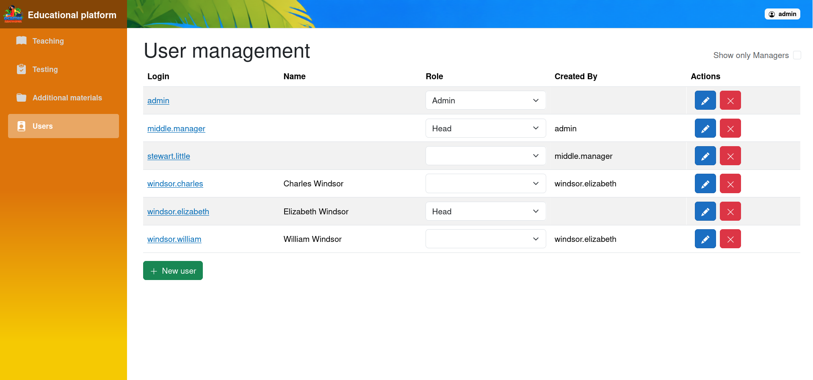
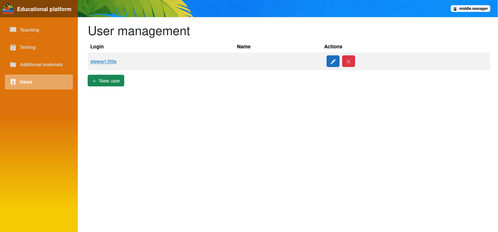
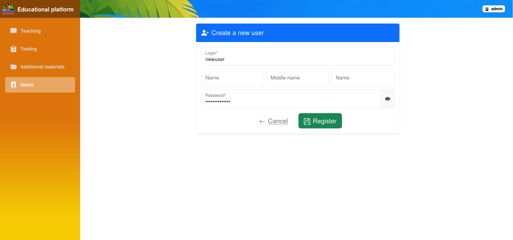
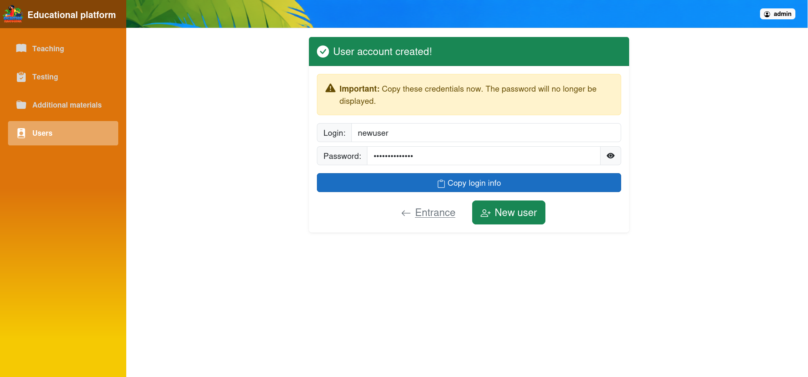
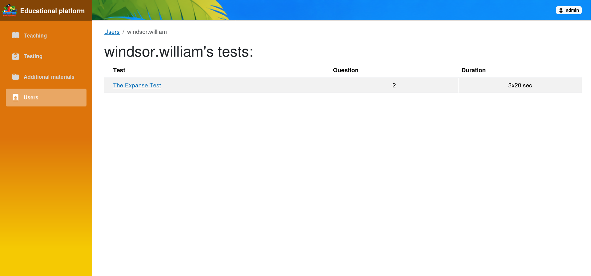

# Users

This page initially follows the same table-based layout as [Courses](https://github.com/Pandora1337/mt-lms/wiki/2.-Teaching) and [Tests](https://github.com/Pandora1337/mt-lms/wiki/3.-Testing), with a notable addition of `Created` field to display who created this user. This functionality was requested as the company is franchising and tracking each branches users is essential.

Since creating and editing users is only possible for the `Manager` role, there is a toggle to filter out all users without the role for quick scanning.

The following is how the page looks for a `Manager`. The role assignment is only available to `Admin`s, and so that column is missing along with the `Created By` since each manager should only see users they created.

# User Form

Standard registration form with a JavaScript password Show toggle (can't escape JS even in a C# framework, *sigh*).

# User Form Completed

Ah! Now it's unusual!

Since only registration of new users is done by `Manager`s or `Admin`s, they need a simple way to send credentials to the soon-to-be user. I created the `Copy login info` button that copies login and password to the clipboard, and I also made sure that older users who are used to selecting text by mouse dragging can also do that here (provided they show the password first).

# User's Tests

By clicking on the user's name, the `Manager` or `Admin` can see that user's tests and their completion. Notice how the `Manager Test` from [Tests](https://github.com/Pandora1337/mt-lms/wiki/3.-Testing) is missing here, since user `windsor.william` does not have a `Manager` role.

As mentioned in the [Testing](https://github.com/Pandora1337/mt-lms/wiki/3.-Testing) section, tests that haven't yet been attempted do not get an icon on the left. In this case, `windsor.william` has not done, nor attempted, `The Expanse` test.